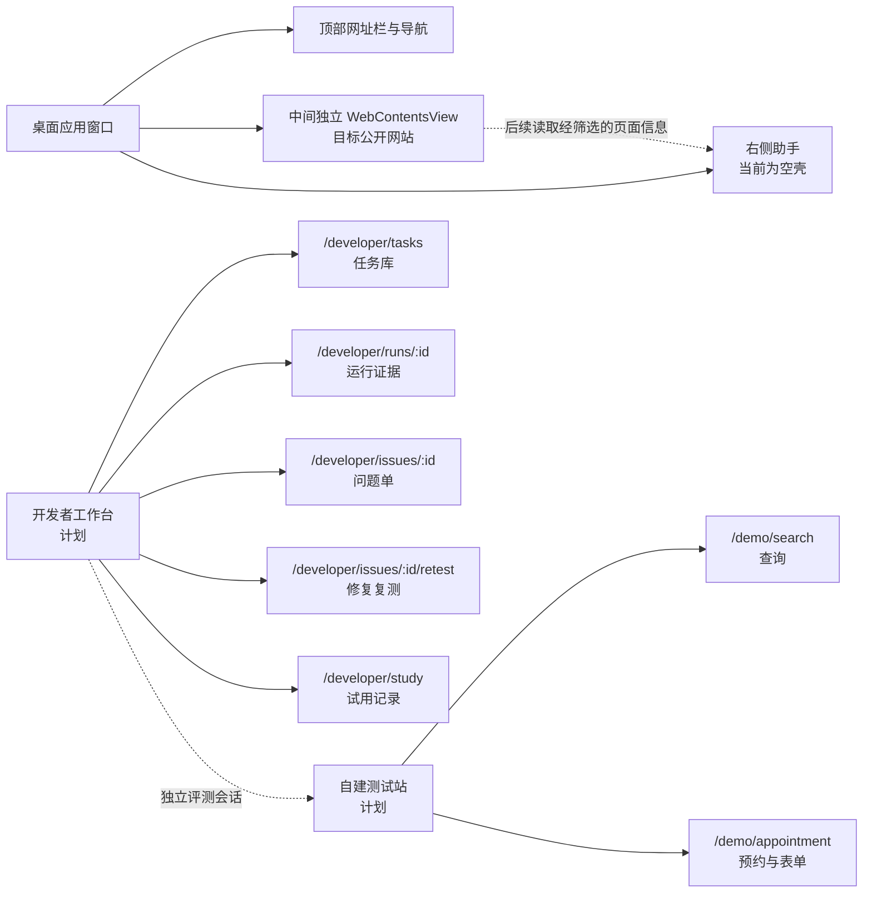

# 站点地图与文件登记

以下是启动周的窗口结构和后续页面规划。“计划”表示尚未实现，不能当作可用入口。



## 当前窗口

```text
┌──────────────────────────────────────────────────────────┐
│ TouchYourWeb  返回 前进 刷新  [网站地址] [打开网页]       │
├────────────────────────────────────┬─────────────────────┤
│                                    │ 右侧助手            │
│  独立 WebContentsView               │ 当前网页与状态       │
│  实际加载用户输入的公开网站          │ 页面理解 / 找入口    │
│                                    │ 后续接入            │
└────────────────────────────────────┴─────────────────────┘
```

应用界面由本地 `src/renderer/` 加载，目标网站由主进程创建的独立 `WebContentsView` 加载。外站不能调用应用的导航 IPC，也没有本地文件或 Node 权限。Mac 和 Windows 开发版共享同一份网页界面和主进程代码。

## 文件登记

| 路径 | 状态 | 用途 / 负责人 |
| --- | --- | --- |
| `README.md`、`AGENTS.md` | 已有 | 开发启动和团队工作说明；苏越维护启动说明。 |
| `package.json`、`package-lock.json` | 本周建立 | 开发命令和 Electron 锁定依赖；苏越。 |
| `src/main.cjs`、`src/navigation.cjs` | 本周建立 | 窗口、外站视图、导航与网址校验；苏越。 |
| `src/preload.cjs` | 本周建立 | 只向本地应用界面暴露导航方法；苏越。 |
| `src/renderer/` | 本周建立 | 同一套 Mac/Windows 网页界面；本周为可运行空壳，后续网址栏与助手的可见交互由巩品言继续完善。 |
| `test/navigation.test.cjs` | 本周建立 | 检查网址校验；苏越。 |
| `docs/site-map.md`、`docs/screenshots/` | 本周建立 | 入口图和成功、失败场景窗口证据；苏越。 |
| `docs/立项申请书.docx`、`docs/总规划/`、`docs/雏雁计划_双端系统代码与技术实现方案.md` | 已有 | 项目依据和逐周规划。 |
| `apps/developer-ui/` 或等效工作台模块 | 待建 | 任务、运行、问题单、复测与试用页面；巩品言负责可见界面，苏越提供评测与主线接口。 |
| `apps/demo-site/` 或等效测试站模块 | 待建 | 可重置的查询、预约、表单和弹窗场景；巩品言负责可见页面，苏越接通任务运行与评测。 |
| 服务端接口与共享任务模块 | 待建 | 任务、运行、问题、试用等数据和跨端契约；苏越负责主线，巩品言参与记录、问题单和试用数据接口。 |

待建路径只是建议；开始对应周次时应先检查实际目录，再定最终位置。

## 两人的入口与交接

| 入口 | 苏越 | 巩品言 |
| --- | --- | --- |
| 桌面窗口与网址栏 | 窗口、真实导航、返回/前进/刷新接口、内置网页视图 | 网址栏外观、键盘操作与可理解的状态 |
| 右侧助手 | 后续提供经筛选的当前页数据与通用操作接口 | 页面概要、提问、步骤、暂停与确认等可见界面 |
| 开发者工作台 | 任务运行、证据、规则和评测接口 | 任务、记录、问题单、复测与试用界面及部分接口 |
| 自建测试站 | 对接任务与评测 | 查询、预约、表单与弹窗的可见页面 |

接口交接先提供地址、输入、正常结果和错误结果。演示数据必须标明“演示”；接通真实网页后再按对应周次任务卡验收。
